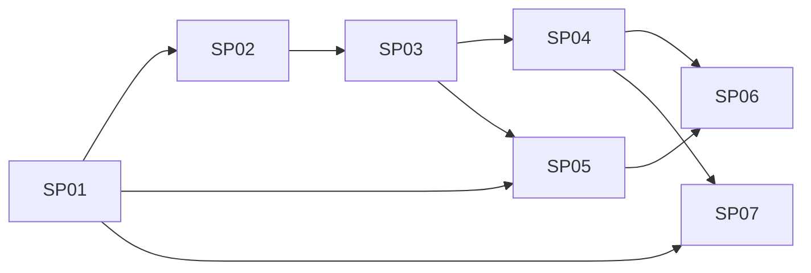

# Real-Time Card Authorization Engine: Brief

> **Status:** Draft v1 · **Last updated:** 2026-11-12 · **Owner:** Brayan Escobar · **Generated with:** `/problem-brief-creator` · **Sources:** [README.md](../README.md), challenge instructions (v1), answers on 2026-11-12

## TL;DR
Build a Go service that answers a card processor's real-time authorization webhook with `APPROVE` / `DECLINE` plus reason codes, using per-company controls, velocity limits and an explainable anomaly score. It must be idempotent, auditable and safe when dependencies fail. It is the Stage 2 submission of a vibe coding challenge, due **2026-11-15**, with a working demo, a 5-minute video and a 1-page write-up.

No requirement conflicts are open. Three features were cut by decision ([D-011](../docs/DECISIONS.md#d-011-mvp-scope-cuts)).

---

## Part 1: Brief

### 1. Context and problem
- Corporate card platforms must decide every swipe in real time. Too permissive means fraud and out-of-policy spend; too strict means false declines; too slow means the processor decides instead (Stripe 2 s, Marqeta 3 s, Lithic 6 s with ≤ 3 s recommended). *(README §5, §6.3)*
- Lithic may send the same request twice, so decisions must be idempotent. *(README §6.3)*
- **Why now:** the challenge asks for a real problem solved as a feature shipped in the first weeks. Deadline 3 days. *(challenge instructions)*

### 2. Goal and success metrics
- **Outcome:** a reviewer can run the engine locally, watch it stop each fraud scenario with a clear reason, and see it stay correct under retries, concurrency and dependency failure.
- **Metrics** *(README §8.2, §15)*:
  - Engine processing p99 < 100 ms locally under load
  - Concurrency: 100 parallel requests on a card that allows 10 → exactly 10 approved
  - Detection rate per simulator scenario and false-decline rate on normal traffic (reported; no target given) `[OPEN Q1]`
  - ≥ 80% coverage on every changed file ([D-015](../docs/DECISIONS.md#d-015-coverage-threshold-80))

### 3. Users and stakeholders
| Who | Role / interest | Involvement |
|---|---|---|
| Brayan Escobar | Candidate, builder | Decides |
| Jeeves engineering reviewers | Evaluate product thinking, engineering, decisions, tool use, communication | Consulted (via submission), uses |
| Finance team (fictional end user) | Needs to know why a transaction was declined or flagged | Uses (explanations, reason codes) |
| Cardholder (fictional end user) | Wants legitimate purchases approved | Affected |

### 4. Scope
**In scope (MVP)** *(README §2, §9)*
- Authorization webhook, lifecycle (reversal, expiry, capture, refund, incremental) and admin endpoints
- Versioned JSON policies with card-level overrides, hard controls
- Redis Lua atomic check-and-reserve for velocity and budget
- Explainable anomaly score (6 features, see D-038) + risk policy (approve / flag / decline)
- Idempotency, internal deadline, per-company fallback, audit log + outbox
- Traffic simulator with labeled scenarios, CLI report, `GET /v1/metrics`
- Mocked LLM explainer (async)

**Out of scope**
- Shadow mode, metrics dashboard UI, partial approval ([D-011](../docs/DECISIONS.md#d-011-mvp-scope-cuts))
- Real LLM connection ([D-013](../docs/DECISIONS.md#d-013-mock-the-llm-explainer)), real processor integration, ML model, ledger/settlement, policy UI, PCI-DSS

### 5. Requirements
- R1–R9: FR1–FR9 in [README §8.1](../README.md#81-functional) (FR7 cut).
- NFR1–NFR8: [README §8.2](../README.md#82-non-functional).
- **R10.** Deliverables: code with a README on how to run it, a ~5-minute video (camera + screen: problem, why, how, code walkthrough, live demo), a 1-page write-up (problem, approach, decisions and trade-offs, AI use, next steps). *(challenge instructions)*
- **R11.** Every decision is logged with what the AI suggested and what was chosen ([D-017](../docs/DECISIONS.md#d-017-log-every-decision)).

### 6. Constraints and dependencies
- **Time:** 2026-11-12 → 2026-11-15, one person.
- **Tech:** Go 1.27 (installed), Postgres + Redis via Docker Compose. **Docker is not installed yet** ([D-019](../docs/DECISIONS.md#d-019-docker-runtime)); a local Postgres 14 already uses port 5432 ([D-020](../docs/DECISIONS.md#d-020-postgres-host-port)).
- **Rules:** must be new work (libraries and boilerplate allowed); runs locally, no deployment needed.

### 7. Acceptance criteria
- **AC1 (R10):** Given a fresh clone with Go and Docker, when a reviewer runs the commands in README §1, then the engine starts and `make simulate` prints a report.
- **AC2 (NFR idempotency):** Given the same request sent twice, then both responses are identical and the amount is counted once.
- **AC3 (NFR consistency):** Given 100 parallel requests on a card whose limit allows 10, then exactly 10 are approved.
- **AC4 (NFR fail-safe):** Given Redis is stopped, when a request arrives, then the company fallback applies within the internal deadline and the decision carries `FALLBACK_APPLIED`.
- **AC5 (NFR latency):** p99 engine processing < 100 ms under a local k6 load test.
- **AC6 (FR8):** Every decision row stores the input, policy version and every rule/feature result.
- **AC7 (NFR explainability):** Every `DECLINE` has ≥ 1 reason code with a message.
- **AC8 (R11, D-015):** Every changed Go file passes `/check-tests -cov 80`.
- Each sub-project brief adds its own criteria.

### 8. Open questions
| # | Question | Who can answer | Blocks |
|---|---|---|---|
| Q1 | Is there a target detection / false-decline rate, or is the report enough? | Brayan | SP06 report, write-up |
| Q2 | ✅ Resolved: D-019 to D-029 accepted on 2026-11-12 | Brayan | See each decision |

---

## Part 2: Insights and key decisions

### Insights
- **The demo is the spec.** The video counts as much as the code, and §17 of the README lists six live moments. Every sub-project should end with something that appears in one of them; anything that doesn't is a candidate for cutting.
- **Reserve-before-score creates a hidden compensation step.** Budget is reserved in stage 3, but stage 4 can still decline. Without a release, declined transactions eat budget and cause false declines on later legitimate swipes. This is [D-023](../docs/DECISIONS.md#d-023-what-happens-to-the-reservation-when-the-score-declines), and it is a strong interview topic.
- **Postgres is in the hot path through idempotency.** The idempotency store is a Postgres table, so "Postgres down" is a failure mode the fallback must handle, not only "Redis down" ([D-024](../docs/DECISIONS.md#d-024-where-the-idempotency-check-lives)).
- **Keeping the full lifecycle loads Day 2.** Velocity, lifecycle, scoring and fallback all land on Nov 13. If Day 2 slips, the fallback (needed for the demo) is at risk before the lifecycle (less visible in the demo).
- **The decision log is itself a deliverable.** The write-up has to explain AI use; the log already separates "AI suggested" from "I decided".

### Key decisions
The full list and status are in [docs/DECISIONS.md](../docs/DECISIONS.md). The ones that gate the most work:

#### D-019 / D-020 / D-021 / D-022: Tooling for the walking skeleton
- **Recommendation:** OrbStack, Postgres on 55432 (revised from 5433), `net/http`, embedded migrations.
- **Reversibility:** two-way door. **Decider / deadline:** Brayan / before SP01.
- **Status:** pending

#### D-023: Reservation when the score declines
- **Recommendation:** reserve, then release in the same request.
- **Reversibility:** two-way door, but it shapes the Lua script. **Decider / deadline:** Brayan / before SP03.
- **Status:** pending

### Risks
| Risk | Likelihood | Impact | Mitigation |
|---|---|---|---|
| Day 2 overload (lifecycle kept) | High | Fallback or scoring slips | Build fallback (SP05) before capture/refund; the lifecycle endpoints are thin once the Lua script exists |
| Docker setup on the reviewer's machine | Medium | AC1 fails | Compose file with no host-specific settings, troubleshooting table in the README |
| Coverage gate slows building | Medium | Time | Run `/check-tests` per sub-project, not per file |
| Weights look arbitrary | Medium | Weak interview answer | Tune against the simulator and show detection vs. false-decline numbers |

---

## Part 3: Suggested breakdown

### Overview
A walking skeleton first (one request in, one audited decision out), then vertical slices that each add a stage to the pipeline and a demo moment, then the simulator and the async explainer.

### Sub-problems
| # | Sub-project | Size / risk | Brief | Day |
|---|---|---|---|---|
| SP01 | Walking skeleton: compose, migrations, endpoint, idempotency, audit | M / low | [01](01-walking-skeleton-brief.md) | Nov 12 |
| SP02 | Policy and hard controls | M / low | [02](02-policy-and-hard-controls-brief.md) | Nov 12 |
| SP03 | Velocity, budget and lifecycle (Lua) | L / high | [03](03-velocity-budget-lifecycle-brief.md) | Nov 13 |
| SP04 | Anomaly scoring and risk policy | M / medium | [04](04-anomaly-scoring-brief.md) | Nov 13 |
| SP05 | Deadline and fallback | M / medium | [05](05-deadline-and-fallback-brief.md) | Nov 13 |
| SP06 | Simulator, report, metrics, load test | M / low | [06](06-simulator-and-report-brief.md) | Nov 14 |
| SP07 | Mocked LLM explainer | S / low | [07](07-mock-llm-explainer-brief.md) | Nov 14 |

### Order and dependencies

Critical path: SP01 → SP02 → SP03 → SP04 → SP06. SP07 can be built in parallel once the outbox exists (SP01).

### Suggested first step
Decide D-019 to D-022 and install the Docker runtime. SP01 can't start without them, and every other sub-project builds on SP01.
